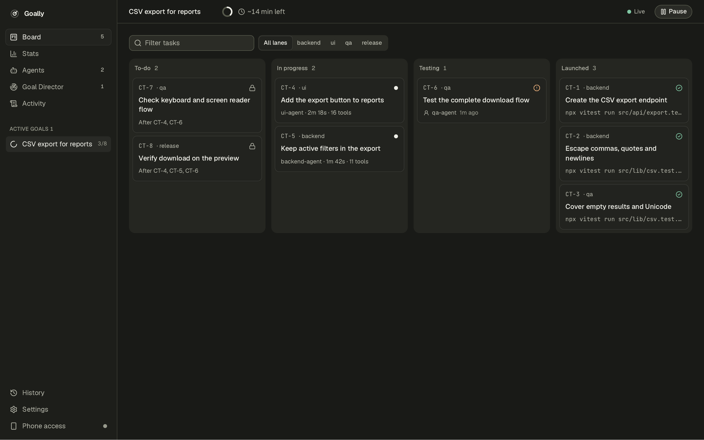
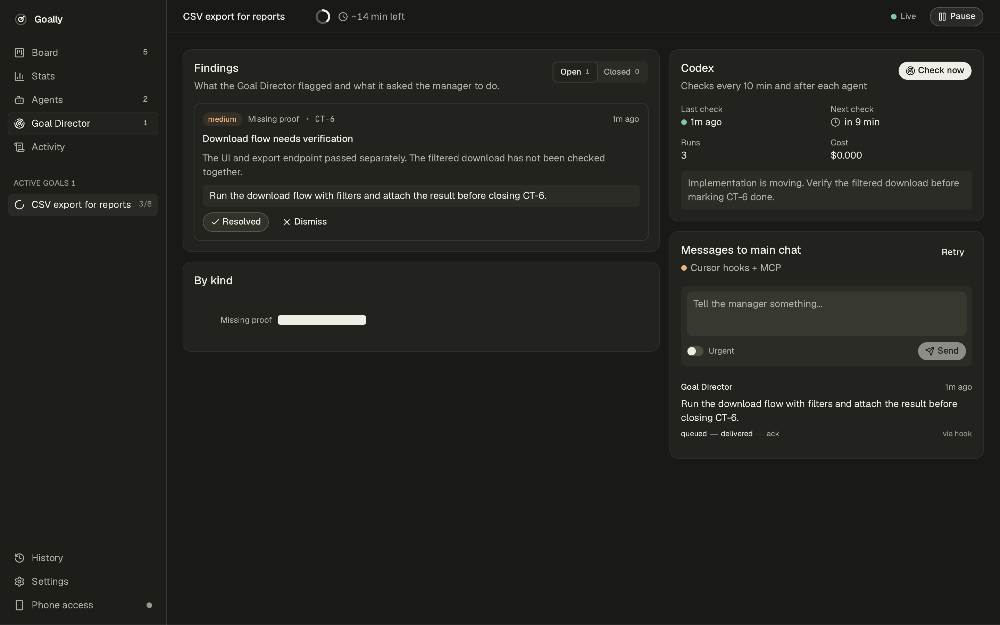
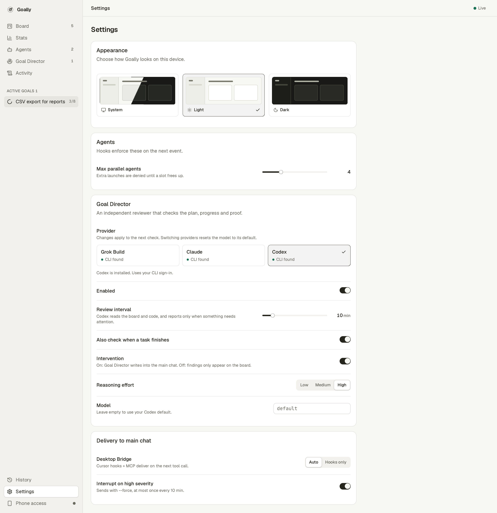

# Goally

Mission control for big agent tasks in Cursor, Claude Code and Codex. You hand the agent a large task; it audits it into tasks, launches parallel subagents within your limit, and a live board shows what is really happening. A task only counts as done when a passing check was observed after the last edit (GO/NO-GO poll). The Goal Director runs through your choice of Grok Build, Claude or Codex, catches over-engineering, stuck agents, full builds and missing proof, and writes corrections straight into the manager chat.

<p align="center">
  
</p>

<p align="center"><sub>Rendered from the actual Goally UI with fictional demo missions and tasks.</sub></p>

## Install

Goally installs into Cursor, Claude Code and Codex (every one it finds). Paste this into any of them:

> Install Goally for me. Follow the steps in https://github.com/jindratilk/goally/blob/main/INSTALL.md exactly, then run `goally doctor` and tell me what's left for me to do.

Or by hand, which is also how you update:

```sh
git clone https://github.com/jindratilk/goally ~/.goally/src   # or: git -C ~/.goally/src pull
sh ~/.goally/src/scripts/install.sh    # --only cursor,claude,codex · --no-start
goally doctor
```

The runtime lives in `~/.goally/app`. Then reload Cursor (Developer: Reload Window), or start a new Claude Code / Codex session. See [INSTALL.md](INSTALL.md) for Goal Director sign-in and Desktop Bridge.

## Use

Cursor and Claude Code: `/goally <big task>`. Codex: `$goally <big task>`. The board opens at http://127.0.0.1:4777.

- `goally demo 4` plays a simulated mission on the board.
- `goally tunnel start` opens a free Cloudflare Quick Tunnel and prints a QR code with a private, read-only phone link (also in the sidebar under Phone access, hover for the QR code).
- `goally send "<text>"` messages the manager from the terminal.

### Settings

- **Goal Director → Provider:** choose Grok Build (the default), Claude or Codex. Install and sign in to that CLI first: `grok login`, `claude auth login` or `codex login`. Switching takes effect on the next check and resets the model to the new CLI's default. Reviews use read-only tools or Codex's read-only sandbox. Conversations are never resumed across providers or models; Codex runs a fresh, ephemeral review each time.
- **Appearance:** System, Light or Dark. The preference is saved in this browser, including on the read-only phone view. System follows changes to your device appearance; the correct theme is applied before the first paint.

For a CLI outside `PATH`, set `GOALLY_GROK_BIN`, `GOALLY_CLAUDE_BIN` or `GOALLY_CODEX_BIN` to its executable path before starting the daemon. Discovery checks that the CLI starts, skips broken launchers, and also checks the bundled Codex CLI in standard macOS app locations. Each provider uses its existing CLI authentication; Goally does not need a separate API key.

<p align="center">
  
</p>

<p align="center">
  
</p>

### Development checks

Use Node 20.19+, 22.12+ or Node 24+ to build the dashboard. The daemon supports Node 20+.

```sh
cd plugin/goally && npm ci && npm test
cd ../../dashboard && npm ci && npm test && npm run build && npm run lint
```

The README images use the unchanged application entry, React components, styles and fonts. A separate build replaces only API responses with the public data in `dashboard/readme/fixtures.ts`. The isolated browser blocks other origins; no daemon, account or stored mission is accessed. Chromium exports the real layout as a vector PDF, and Poppler renders it to PNG.

Install Poppler (`brew install poppler` on macOS, `apt install poppler-utils` on Debian/Ubuntu), then regenerate the images:

```sh
cd dashboard
npm ci
npx playwright install chromium
npm run render:readme
npm run render:readme -- --check
```

## How it fits together

| Part | Where | Role |
| --- | --- | --- |
| Skill | `plugin/goally/skills/goally` | Mission protocol for the manager agent |
| MCP | `goally.mjs mcp` | `goally_start_run`, `goally_complete_task` (proof check), `goally_ack`, `goally_status`, … |
| Hooks | `hooks/hooks.json` → `bin/hook.sh` | Record subagents, tools, tests, builds, edits; enforce the parallel limit; deliver messages |
| Daemon | `127.0.0.1:4777` | Event log per mission in `~/.goally/missions`, API, dashboard, Goal Director, tunnel |
| Dashboard | `dashboard/` (Vite, React, Tailwind v4, shadcn, Motion, Recharts) | Board, poll, fleet, director inbox, charts, telemetry, settings |

Security: the daemon listens on loopback only, hooks and MCP use a local 0600 token, dashboard writes are local only, and the tunnel view is read-only behind a rotating private key.
